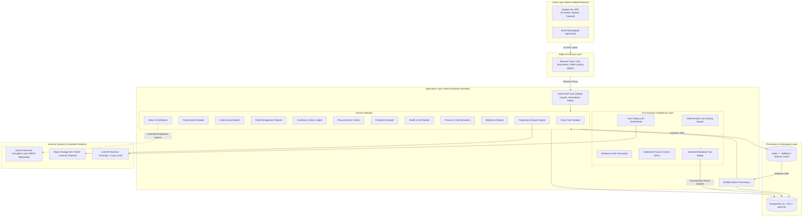
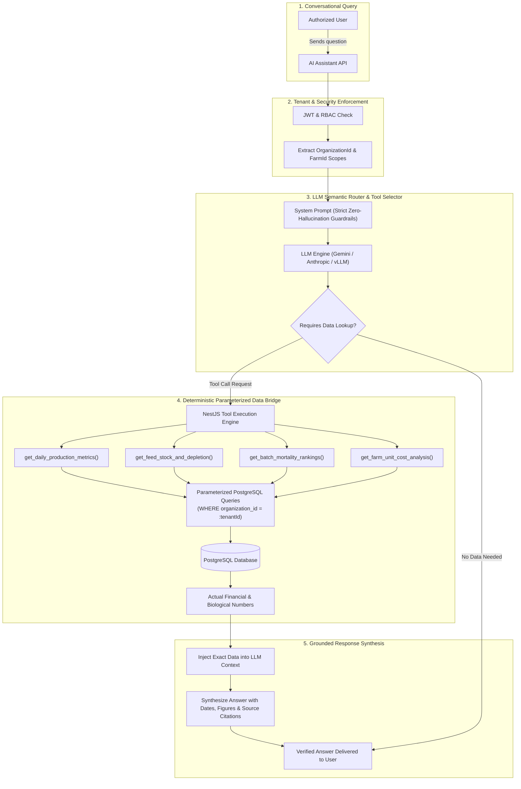
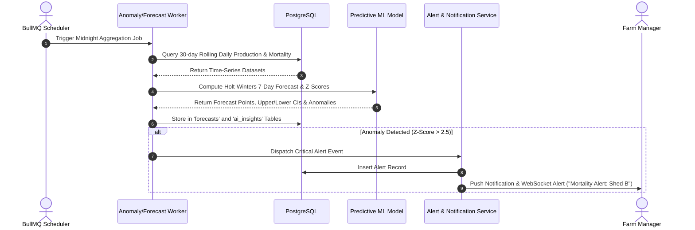
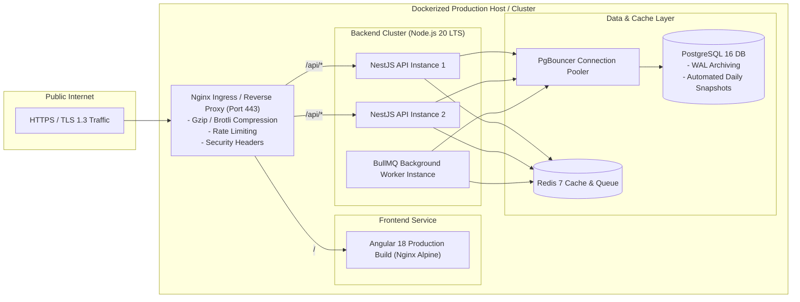
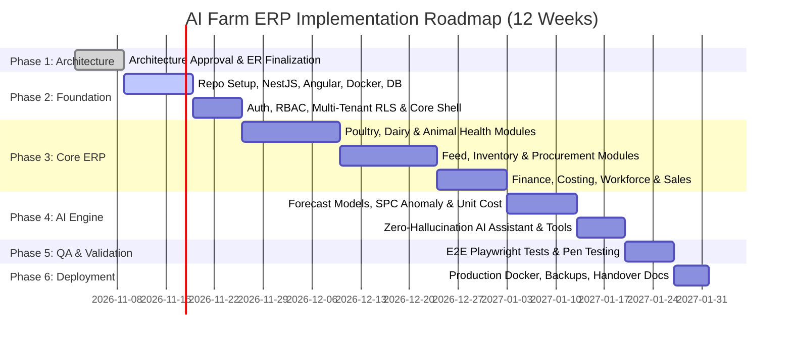

# AI Farm ERP Intelligence Platform: Architecture & Implementation Proposal

**Document Version:** 1.0.0  
**Role:** Senior Full-Stack Developer & Technical Architect  
**Project:** AI Farm ERP Intelligence Platform  
**Target Architecture:** Multi-Organization, Multi-Farm Cloud-Native ERP with Deterministic & Predictive AI Intelligence  
**Author:** Technical Architecture Team  
**Date:** November 2, 2026  

---

## 1. Executive Summary & Architectural Philosophy

The **AI Farm ERP Intelligence Platform** is engineered from the ground up as a production-grade, centralized, multi-tenant agricultural enterprise resource planning system. Unlike traditional "passive data-entry" ERPs, this platform integrates a **Hybrid AI Intelligence Engine** that operates directly on live operational data to deliver:
1. **Predictive Operations:** Accurate forecasting of milk, egg, and poultry yields; feed depletion timelines; and proactive reorder recommendations.
2. **Deterministic Financial Truth:** Automated unit-economics engine computing exact cost-per-litre of milk, cost-per-egg, and cost-per-kg of broiler/country chicken using FIFO/weighted-average inventory costing and activity-based labor/veterinary allocation.
3. **Operational Anomaly Detection:** Automated statistical process control (SPC) and machine learning algorithms flagging mortality spikes, sudden yield drops, and expense deviations.
4. **Zero-Hallucination Conversational Assistant:** An enterprise AI assistant powered by constrained Tool-Calling / Semantic Query Routing that executes validated PostgreSQL queries through strict Role-Based Access Control (RBAC) and tenant boundaries, completely eliminating fabricated metrics.
5. **Strict Boundary with Aroha Fresh:** Complete separation from existing MongoDB services, providing isolated PostgreSQL persistence with clean Anti-Corruption Layer (ACL) interfaces for future external integration.

---

## 2. Requirement Analysis & Domain Modeling

### 2.1 Domain Overview & Business Context
Agricultural operations feature high biological variability, perishable commodities, volatile feed ingredient markets, and strict biosecurity and animal welfare requirements. The platform unifies three primary livestock and production paradigms alongside core enterprise functions:

```
+-----------------------------------------------------------------------------------+
|                        Multi-Organization Enterprise Scope                         |
+-----------------------------------------------------------------------------------+
| Organization A (e.g., Commercial Poultry & Layer) | Organization B (Dairy & Feed) |
+-----------------------------------------------------------------------------------+
| Farms -> Sheds/Barns -> Flocks/Herds -> Feed Stations -> Storage Warehouses       |
+-----------------------------------------------------------------------------------+
| Operations: Poultry | Dairy | Feed | Inventory | Procurement | Production | Sales |
+-----------------------------------------------------------------------------------+
| Intelligence: Forecasting | Anomaly Detection | Unit Costing | LLM Assistant      |
+-----------------------------------------------------------------------------------+
```

### 2.2 Core Personas & User Journeys
1. **Super Admin (Platform Owner):** Multi-tenant lifecycle management, system-wide telemetry, global configuration, billing, and platform audit logs.
2. **Organization Executive / Managing Director:** Portfolio-wide P&L, farm comparison dashboards, capital expenditure approvals, macro-level production forecasting, and ROI analytics.
3. **Farm Manager:** Daily operational dashboard, batch lifecycle management, mortality escalation, feed allocation, workforce assignment, and shift sign-offs.
4. **Veterinarian / Animal Health Officer:** Vaccination scheduling, disease diagnosis logs, treatment prescription, quarantine tracking, and withdrawal period monitoring.
5. **Feed & Inventory Officer:** Material receipt (GRN), quality inspection, recipe formulation, bin level monitoring, stock adjustments, and batch issue tracking.
6. **Financial Controller / Accountant:** Direct/indirect expense logging, vendor invoices, payment reconciliation, sales order invoicing, and cost allocation verification.
7. **Field Operator / Shed Supervisor:** Low-friction mobile/tablet daily data entry (mortality counts, temperature, humidity, egg collection, milk meter entries).

### 2.3 Non-Functional Requirements (NFRs)
- **Data Isolation & Multi-Tenancy:** Zero cross-tenant data leakage guaranteed at both database layer (PostgreSQL Row-Level Security) and application layer (NestJS AsyncLocalStorage context).
- **Latency & Performance:** API response time (p95) < 120ms for transactional CRUD; < 400ms for complex analytical rollups; streaming LLM responses < 1.5s First Token.
- **Data Integrity & Concurrency:** Pessimistic/Optimistic locking on inventory ledger and batch states to prevent double-allocation or negative inventory during concurrent updates.
- **Availability & Resilience:** 99.95% uptime architecture, automated health probes, database connection pooling with PgBouncer, and asynchronous non-blocking job execution via BullMQ + Redis.
- **Auditability:** Complete immutable append-only audit trail for financial transactions, animal mortality, and security-critical state changes.
- **Offline / Low-Connectivity Resilience:** Optimized payload sizes and transactional idempotency keys (`idempotency_key` header) to support intermittent rural farm network conditions.

---

## 3. High-Level System Architecture

The system follows a **Modular Monolith** architecture inside NestJS, architecturally enforced with strict domain boundaries and event-driven decoupled communication. This guarantees maximum velocity, atomic database transactions across business domains, and zero microservice networking overhead, while remaining structured for extraction into independent microservices if organizational scale demands it.

### 3.1 Architectural Topology (C4 Container View)



---

## 4. Folder Structure (Frontend & Backend)

### 4.1 Backend Architecture: NestJS Clean Modular Structure
The backend is structured to separate transport (Controllers), business orchestration (Services), data access (Repositories), and domain contracts (DTOs & Entities).

```
farm-erp-backend/
├── src/
│   ├── app.module.ts                   # Root application module orchestrating sub-modules
│   ├── main.ts                         # Bootstrap entrypoint (Swagger, CORS, Helmet, Pipes)
│   ├── common/                         # Shared cross-cutting concerns
│   │   ├── constants/                  # System-wide enum constants and tokens
│   │   ├── decorators/                 # Custom decorators (@CurrentUser, @TenantId, @Roles)
│   │   ├── filters/                    # Centralized RFC-7807 Exception Filters
│   │   ├── guards/                     # JwtAuthGuard, RolesGuard, TenantIsolationGuard
│   │   ├── interceptors/               # AuditLogInterceptor, TransformResponseInterceptor
│   │   ├── middleware/                 # AsyncLocalStorage TenantContextMiddleware
│   │   ├── pipes/                      # Custom Zod / class-validator validation pipes
│   │   └── utils/                      # Math, date-fns, and currency formatting helpers
│   ├── config/                         # Environment schema validation (Joi/Zod)
│   ├── database/                       # Database layer
│   │   ├── database.module.ts          # TypeORM/Prisma client configuration
│   │   ├── migrations/                 # Versioned SQL migration files
│   │   ├── seeds/                      # Deterministic development & test seeders
│   │   └── base.entity.ts              # Abstract base entity (UUID, created_at, updated_at, tenant_id)
│   ├── modules/                        # Business Domain Modules
│   │   ├── auth/                       # JWT, Refresh Tokens, Password Hashing, MFA
│   │   ├── organization/               # Organizations, Subscriptions, Global Settings
│   │   ├── farm/                       # Farms, Locations, Sheds, Barns, IoT Gateways
│   │   ├── poultry/                    # Flocks, Batches, Daily Counts, Growth Tracking
│   │   ├── dairy/                      # Animal Master, Milking Meters, Lactation Records
│   │   ├── feed/                       # Formulations, Feed Batches, Daily Distribution
│   │   ├── inventory/                  # Items, Warehouses, Stock Ledger (Double-Entry)
│   │   ├── procurement/                # Vendors, Purchase Requests, Purchase Orders, GRNs
│   │   ├── production/                 # Milk bulk tanks, Egg grading, Meat processing
│   │   ├── animal-health/              # Disease logs, Vaccines, Drug withdrawals, Vet visits
│   │   ├── finance/                    # General Ledger, Cost Centers, Expense Allocation
│   │   ├── workforce/                  # Staff, Shifts, Biometric logs, Task assignments
│   │   ├── sales/                      # Customers, Sales Orders, Invoicing, Dispatch
│   │   ├── reports/                    # Tabular/PDF/Excel generation (ExcelJS, Puppeteer)
│   │   ├── ai-intelligence/            # AI Engine Subsystem
│   │   │   ├── ai.module.ts
│   │   │   ├── controllers/            # AI Query endpoints & forecast triggers
│   │   │   ├── services/
│   │   │   │   ├── unit-costing.service.ts      # Deterministic mathematical cost engine
│   │   │   │   ├── time-series-forecaster.ts    # Holt-Winters / SARIMAX / Regression
│   │   │   │   ├── anomaly-detection.service.ts # SPC / Z-score & Outlier detectors
│   │   │   │   ├── ai-assistant.service.ts      # LLM Agent & Function-Calling Orchestrator
│   │   │   │   └── tools/                       # Strictly-typed SQL execution tools
│   │   │   │       ├── metrics-tool.ts
│   │   │   │       ├── inventory-tool.ts
│   │   │   │       └── financial-tool.ts
│   │   │   └── prompts/                # Guardrailed system prompts with few-shot examples
│   │   └── integration/                # Aroha Fresh Anti-Corruption Layer (ACL)
│   └── queues/                         # BullMQ queue definitions and workers
│       ├── queue.module.ts
│       ├── processors/
│       │   ├── forecast-computation.processor.ts
│       │   ├── anomaly-scanner.processor.ts
│       │   └── report-generation.processor.ts
│       └── schedulers/                 # Cron triggers (midnight rollups, hourly alerts)
├── test/                               # Test suites
│   ├── e2e/                            # Supertest API End-to-End tests
│   ├── integration/                    # Testcontainers PostgreSQL/Redis integration tests
│   └── mocks/                          # Fixtures & deterministic mock data
├── docker-compose.yml
├── Dockerfile
├── package.json
└── tsconfig.json
```

### 4.2 Frontend Architecture: Angular 18+ Standalone with PrimeNG
The frontend leverages modern Angular (Standalone Components, Signals for fine-grained reactivity, inject() syntax, PrimeNG UI Suite, and PrimeFlex/Tailwind for utility styling).

```
farm-erp-frontend/
├── src/
│   ├── index.html
│   ├── main.ts                         # Standalone bootstrap application
│   ├── app/
│   │   ├── app.config.ts               # HTTP Interceptors, PrimeNG config, Router providers
│   │   ├── app.routes.ts               # Lazy-loaded feature route definitions
│   │   ├── core/                       # Singleton infrastructure services
│   │   │   ├── auth/                   # AuthService, TokenStorage, AuthGuard, RoleGuard
│   │   │   ├── http/                   # ApiPrefixInterceptor, ErrorInterceptor, TenantInterceptor
│   │   │   ├── layout/                 # AppShell, Topbar, Sidebar, Breadcrumb, Footer
│   │   │   ├── state/                  # Global signals (active organization, active farm, theme)
│   │   │   └── services/               # NotificationService, WebSocketsService
│   │   ├── shared/                     # Reusable UI components & pipes
│   │   │   ├── components/
│   │   │   │   ├── kpi-card/           # Metric display cards with trend indicator
│   │   │   │   ├── data-table/         # PrimeNG Table wrapper with search, filter, export
│   │   │   │   ├── status-badge/       # Status chip (Pending, Completed, Critical, Healthy)
│   │   │   │   ├── confirmation-dialog/# Modal wrapper for high-risk actions
│   │   │   │   └── chart-wrapper/      # Chart.js / PrimeNG Charts wrapper
│   │   │   ├── directives/             # HasPermissionDirective, NumericOnlyDirective
│   │   │   └── pipes/                  # CurrencyFormatPipe, MetricUnitPipe, RelativeTimePipe
│   │   └── features/                   # Lazy-Loaded Business Modules
│   │       ├── auth/                   # Login, Forgot Password, Tenant Switcher
│   │       ├── dashboard/              # Executive & Farm Operational KPI Dashboards
│   │       ├── organization/           # Org settings, User management, Farm provision
│   │       ├── farm/                   # Facility map, Shed layout, Sensor overview
│   │       ├── poultry/                # Batch ledger, Mortality curve, Weight chart
│   │       ├── dairy/                  # Herd registry, Milk recording sheet, Lactation curves
│   │       ├── feed/                   # Formula builder, Bin monitors, Consumption sheets
│   │       ├── inventory/              # Real-time stock, Ledger history, Stock adjustment
│   │       ├── procurement/            # PO lifecycle, Vendor comparison, Goods Receipt
│   │       ├── production/             # Daily collection logs, Packaging, Quality check
│   │       ├── animal-health/          # Vaccine calendar, Drug register, Quarantine log
│   │       ├── finance/                # Cost ledger, Unit economics cards, Expense claims
│   │       ├── workforce/              # Roster, Shift logging, Labour cost distribution
│   │       ├── sales/                  # Sales orders, Delivery dispatches, Invoicing
│   │       ├── reports/                # Report builder, Export scheduler (Excel/PDF)
│   │       └── ai-intelligence/        # AI Hub
│   │           ├── ai-dashboard/       # Forecast curves, Anomaly alerts, Margin drivers
│   │           └── ai-assistant/       # Interactive conversational assistant chat drawer
│   ├── assets/                         # Icons, branding images, sounds
│   ├── styles/                         # PrimeNG theme overrides, SCSS variables, Tailwind
│   └── environments/                   # environment.ts and environment.prod.ts
├── angular.json
├── package.json
└── tsconfig.json
```

---

## 5. PostgreSQL ER Diagram & Data Modeling

The database schema is normalized to 3NF, utilizing native PostgreSQL capabilities including UUIDv7/v4 primary keys, JSONB for flexible telemetry/specifications, check constraints for data sanity, and compound indexes for high-throughput tenant filtering.

```mermaid
erDiagram
    ORGANIZATIONS ||--o{ FARMS : owns
    ORGANIZATIONS ||--o{ USERS : employs
    ORGANIZATIONS ||--o{ ROLES : defines
    USERS ||--o{ USER_FARM_MAPPINGS : assigned_to
    FARMS ||--o{ SHEDS : contains
    FARMS ||--o{ USER_FARM_MAPPINGS : staffed_by

    FARMS ||--o{ POULTRY_BATCHES : houses
    SHEDS ||--o{ POULTRY_BATCHES : accommodates
    POULTRY_BATCHES ||--o{ DAILY_POULTRY_LOGS : records
    POULTRY_BATCHES ||--o{ MORTALITY_RECORDS : incurs

    FARMS ||--o{ ANIMALS : maintains
    SHEDS ||--o{ ANIMALS : shelters
    ANIMALS ||--o{ MILK_COLLECTIONS : produces
    ANIMALS ||--o{ HEALTH_RECORDS : undergoes
    ANIMALS ||--o{ VACCINATION_RECORDS : receives

    FARMS ||--o{ FEED_CONSUMPTIONS : consumes
    FEED_ITEMS ||--o{ FEED_RECIPE_ITEMS : ingredients
    FEED_RECIPES ||--o{ FEED_RECIPE_ITEMS : composed_of
    FEED_RECIPES ||--o{ FEED_CONSUMPTIONS : formulated_as

    ORGANIZATIONS ||--o{ INVENTORY_ITEMS : catalogues
    FARMS ||--o{ INVENTORY_TRANSACTIONS : conducts
    INVENTORY_ITEMS ||--o{ INVENTORY_TRANSACTIONS : tracks

    ORGANIZATIONS ||--o{ SUPPLIERS : partners
    SUPPLIERS ||--o{ PURCHASE_ORDERS : receives
    PURCHASE_ORDERS ||--o{ PURCHASE_ORDER_ITEMS : contains
    PURCHASE_ORDERS ||--o{ GOODS_RECEIPTS : fulfilled_by
    GOODS_RECEIPTS ||--o{ GOODS_RECEIPT_ITEMS : details

    FARMS ||--o{ DAILY_PRODUCTIONS : yields
    FARMS ||--o{ EXPENSES : incurs
    ORGANIZATIONS ||--o{ CUSTOMERS : serves
    CUSTOMERS ||--o{ SALES_ORDERS : places
    SALES_ORDERS ||--o{ SALES_ORDER_ITEMS : lists

    FARMS ||--o{ EMPLOYEES : employs
    EMPLOYEES ||--o{ WORKFORCE_ATTENDANCE : logs
    EMPLOYEES ||--o{ WORKFORCE_TASKS : executes

    ORGANIZATIONS ||--o{ AI_INSIGHTS : generates
    FARMS ||--o{ AI_INSIGHTS : concerns
    FARMS ||--o{ FORECASTS : projects
    FARMS ||--o{ ALERTS : triggers
    ORGANIZATIONS ||--o{ AUDIT_LOGS : audits
```



---

## 6. Comprehensive Database Table Design & Data Dictionary

Below is the production DDL and data dictionary specifying all core entities, data types, constraints, and relational indices.

### 6.1 Tenancy & Security Tables

#### `organizations`
| Column | Type | Constraints | Description |
|---|---|---|---|
| `id` | UUID | PK, default `gen_random_uuid()` | Unique Organization ID |
| `name` | VARCHAR(150) | NOT NULL | Business entity name |
| `code` | VARCHAR(30) | NOT NULL, UNIQUE | Unique slug identifier |
| `currency` | VARCHAR(3) | NOT NULL, DEFAULT 'INR' | Standard operating currency (ISO-4217) |
| `is_active` | BOOLEAN | NOT NULL, DEFAULT TRUE | Status toggle |
| `settings` | JSONB | NOT NULL, DEFAULT '{}' | Custom business rules & threshold config |
| `created_at` | TIMESTAMPTZ | NOT NULL, DEFAULT NOW() | Audit timestamp |
| `updated_at` | TIMESTAMPTZ | NOT NULL, DEFAULT NOW() | Audit timestamp |

#### `users`
| Column | Type | Constraints | Description |
|---|---|---|---|
| `id` | UUID | PK | Unique User ID |
| `organization_id` | UUID | FK -> organizations(id), NOT NULL | Parent tenant |
| `email` | VARCHAR(255) | NOT NULL | Work email (Composite unique with org) |
| `password_hash` | VARCHAR(255) | NOT NULL | Argon2id / bcrypt password hash |
| `first_name` | VARCHAR(80) | NOT NULL | First name |
| `last_name` | VARCHAR(80) | NOT NULL | Last name |
| `phone` | VARCHAR(25) | NULL | Contact number |
| `is_active` | BOOLEAN | NOT NULL, DEFAULT TRUE | Account state |
| `created_at` | TIMESTAMPTZ | NOT NULL, DEFAULT NOW() | Audit timestamp |
| `updated_at` | TIMESTAMPTZ | NOT NULL, DEFAULT NOW() | Audit timestamp |
*Indexes:* `UNIQUE(organization_id, email)`

#### `roles` & `permissions`
- `roles`: `(id, organization_id, name, description, is_system_role)`
- `permissions`: `(id, code, module, description)` e.g., `poultry:create`, `finance:approve`
- `role_permissions`: `(role_id, permission_id)`
- `user_roles`: `(user_id, role_id, farm_id)` (Supports global org role OR farm-specific scoping)

---

### 6.2 Farm Infrastructure & Resource Master

#### `farms`
| Column | Type | Constraints | Description |
|---|---|---|---|
| `id` | UUID | PK | Unique Farm ID |
| `organization_id` | UUID | FK -> organizations(id), NOT NULL | Tenant boundary |
| `name` | VARCHAR(120) | NOT NULL | Farm title (e.g., 'Green Valley Dairy Unit 1') |
| `farm_type` | VARCHAR(40) | NOT NULL | Enum: `POULTRY`, `DAIRY`, `INTEGRATED`, `FEED_MILL` |
| `latitude` | DECIMAL(10,8) | NULL | GPS location |
| `longitude` | DECIMAL(11,8) | NULL | GPS location |
| `address` | TEXT | NOT NULL | Physical address |
| `total_area_acres`| DECIMAL(8,2) | NULL | Farm physical footprint |
| `created_at` | TIMESTAMPTZ | NOT NULL, DEFAULT NOW() | Audit timestamp |
*Indexes:* `INDEX(organization_id, farm_type)`

#### `sheds` (Barns / Houses / Pens)
| Column | Type | Constraints | Description |
|---|---|---|---|
| `id` | UUID | PK | Shed Identifier |
| `farm_id` | UUID | FK -> farms(id), NOT NULL | Parent farm |
| `name` | VARCHAR(80) | NOT NULL | Shed Code (e.g., 'Shed B-04') |
| `shed_type` | VARCHAR(40) | NOT NULL | `BROILER`, `LAYER`, `MILKING_PARLOR`, `CALF_PEN` |
| `capacity` | INTEGER | NOT NULL, CHECK(capacity > 0) | Max biological capacity |
| `is_active` | BOOLEAN | NOT NULL, DEFAULT TRUE | Operational state |
*Indexes:* `INDEX(farm_id)`

---

### 6.3 Livestock & Batch Records

#### `poultry_batches`
| Column | Type | Constraints | Description |
|---|---|---|---|
| `id` | UUID | PK | Unique Batch ID |
| `organization_id` | UUID | FK -> organizations(id), NOT NULL | Tenant ID |
| `farm_id` | UUID | FK -> farms(id), NOT NULL | Assigned farm |
| `shed_id` | UUID | FK -> sheds(id), NOT NULL | Assigned shed |
| `batch_code` | VARCHAR(50) | NOT NULL | Human identifier (e.g., 'BATCH-2026-CH-09') |
| `bird_type` | VARCHAR(40) | NOT NULL | `BROILER`, `LAYER`, `COUNTRY_CHICKEN`, `BREEDER` |
| `breed` | VARCHAR(80) | NOT NULL | Breed (e.g., Cobb 500, Ross 308, Aseel, Kadaknath) |
| `initial_bird_count`| INTEGER | NOT NULL, CHECK(initial_bird_count > 0) | Placement quantity |
| `current_bird_count`| INTEGER | NOT NULL, CHECK(current_bird_count >= 0) | Live count |
| `placement_date` | DATE | NOT NULL | Inception date |
| `expected_harvest_date` | DATE | NULL | Target liquidation date |
| `status` | VARCHAR(30) | NOT NULL | `PLANNED`, `ACTIVE`, `HARVESTED`, `DEPLETED` |
| `unit_cost_at_placement` | DECIMAL(12,4) | NOT NULL | Initial DOC (Day Old Chick) unit cost |
*Indexes:* `INDEX(farm_id, status)`, `UNIQUE(organization_id, batch_code)`

#### `daily_poultry_logs` (Daily bird count, mortality, growth)
| Column | Type | Constraints | Description |
|---|---|---|---|
| `id` | UUID | PK | Log Identifier |
| `batch_id` | UUID | FK -> poultry_batches(id), NOT NULL | Linked batch |
| `log_date` | DATE | NOT NULL | Observation date |
| `mortality_count` | INTEGER | NOT NULL, DEFAULT 0 | Dead birds found |
| `culling_count` | INTEGER | NOT NULL, DEFAULT 0 | Weak/diseased culled birds |
| `average_weight_grams` | DECIMAL(8,2) | NULL | Sample weigh-in average |
| `feed_consumed_kg` | DECIMAL(10,2) | NOT NULL, DEFAULT 0 | Feed intake for the day |
| `water_consumed_litres`| DECIMAL(10,2) | NULL | Water intake |
| `temperature_celsius` | DECIMAL(5,2) | NULL | Shed ambient temperature |
| `humidity_pct` | DECIMAL(5,2) | NULL | Shed relative humidity |
| `remarks` | TEXT | NULL | Observations |
*Indexes:* `UNIQUE(batch_id, log_date)`

#### `animals` (Dairy Cattle / Buffaloes)
| Column | Type | Constraints | Description |
|---|---|---|---|
| `id` | UUID | PK | Animal ID |
| `organization_id` | UUID | FK -> organizations(id), NOT NULL | Tenant ID |
| `farm_id` | UUID | FK -> farms(id), NOT NULL | Farm location |
| `shed_id` | UUID | FK -> sheds(id), NULL | Shed location |
| `tag_number` | VARCHAR(50) | NOT NULL | RFID / Ear tag ID |
| `species` | VARCHAR(30) | NOT NULL | `COW`, `BUFFALO` |
| `breed` | VARCHAR(80) | NOT NULL | `HOLSTEIN_FRIESIAN`, `JERSEY`, `GIR`, `MURRAH` |
| `gender` | VARCHAR(10) | NOT NULL, DEFAULT 'FEMALE' | Gender |
| `birth_date` | DATE | NULL | Date of birth |
| `lactation_stage` | VARCHAR(30) | NULL | `EARLY`, `MID`, `LATE`, `DRY`, `HEIFER` |
| `lactation_number`| INTEGER | NOT NULL, DEFAULT 0 | Parity (calving count) |
| `health_status` | VARCHAR(30) | NOT NULL, DEFAULT 'HEALTHY' | `HEALTHY`, `UNDER_TREATMENT`, `QUARANTINED` |
*Indexes:* `UNIQUE(organization_id, tag_number)`, `INDEX(farm_id, health_status)`

#### `milk_collections`
| Column | Type | Constraints | Description |
|---|---|---|---|
| `id` | UUID | PK | Collection ID |
| `farm_id` | UUID | FK -> farms(id), NOT NULL | Farm |
| `animal_id` | UUID | FK -> animals(id), NULL | Specific animal (NULL if bulk parlor) |
| `collection_date`| DATE | NOT NULL | Milking date |
| `shift` | VARCHAR(15) | NOT NULL | `MORNING`, `EVENING`, `AFTERNOON` |
| `quantity_litres`| DECIMAL(8,2) | NOT NULL, CHECK(quantity_litres >= 0) | Milk yield in litres |
| `fat_percentage` | DECIMAL(4,2) | NULL, CHECK(fat_percentage BETWEEN 1 AND 15) | Quality: Fat % |
| `snf_percentage` | DECIMAL(4,2) | NULL, CHECK(snf_percentage BETWEEN 4 AND 15) | Quality: Solids-Not-Fat % |
| `temperature_celsius` | DECIMAL(4,1) | NULL | Bulk tank chilling temp |
*Indexes:* `INDEX(farm_id, collection_date, shift)`, `INDEX(animal_id, collection_date)`

---

### 6.4 Feed & Inventory Subsystem

#### `feed_items` (Ingredients & Concentrates)
| Column | Type | Constraints | Description |
|---|---|---|---|
| `id` | UUID | PK | Feed Item ID |
| `organization_id` | UUID | FK -> organizations(id), NOT NULL | Tenant ID |
| `name` | VARCHAR(120) | NOT NULL | e.g., 'Maize Grits', 'Soybean Meal 48%', 'Broiler Starter' |
| `category` | VARCHAR(40) | NOT NULL | `RAW_INGREDIENT`, `FINISHED_FEED`, `SUPPLEMENT` |
| `uom` | VARCHAR(15) | NOT NULL, DEFAULT 'KG' | Unit of Measure (KG, TONNE) |
| `standard_cost` | DECIMAL(12,4) | NOT NULL | Baseline cost per UOM |
| `reorder_threshold_kg` | DECIMAL(10,2) | NOT NULL, DEFAULT 500.00 | Minimum safe stock level |
| `protein_pct` | DECIMAL(5,2) | NULL | Nutritional crude protein % |
| `metabolic_energy_kcal`| DECIMAL(8,2) | NULL | Nutritional energy |

#### `feed_recipes` & `feed_recipe_items`
- `feed_recipes`: `(id, organization_id, name, target_species, standard_batch_size_kg)`
- `feed_recipe_items`: `(id, recipe_id, feed_item_id, inclusion_pct, quantity_kg)`

#### `inventory_transactions` (Double-Entry Ledger)
To guarantee strict auditability and eliminate stock discrepancies, inventory uses an append-only transaction ledger:
| Column | Type | Constraints | Description |
|---|---|---|---|
| `id` | UUID | PK | Transaction ID |
| `organization_id` | UUID | FK -> organizations(id), NOT NULL | Tenant ID |
| `farm_id` | UUID | FK -> farms(id), NOT NULL | Farm warehouse |
| `item_id` | UUID | FK -> feed_items(id) / inventory_items(id) | Item ID |
| `transaction_type`| VARCHAR(40) | NOT NULL | `PURCHASE_RECEIPT`, `BATCH_CONSUMPTION`, `TRANSFER_OUT`, `TRANSFER_IN`, `WASTAGE_WRITE_OFF`, `INVENTORY_AUDIT_ADJUSTMENT` |
| `quantity` | DECIMAL(12,4) | NOT NULL | Signed quantity (+ for in, - for out) |
| `unit_price` | DECIMAL(12,4) | NOT NULL | Cost price at moment of transaction |
| `reference_entity`| VARCHAR(50) | NULL | e.g., 'purchase_orders', 'poultry_batches' |
| `reference_id` | UUID | NULL | Foreign entity ID |
| `created_by` | UUID | FK -> users(id), NOT NULL | Acting user |
| `created_at` | TIMESTAMPTZ | NOT NULL, DEFAULT NOW() | Immutable timestamp |
*Indexes:* `INDEX(farm_id, item_id, created_at)`

---

### 6.5 Procurement & Finance Tables

#### `purchase_orders` & `goods_receipts`
- `purchase_orders`: `(id, organization_id, farm_id, supplier_id, po_number, status, total_amount, order_date, expected_delivery_date)`
- `purchase_order_items`: `(id, purchase_order_id, item_id, ordered_quantity, unit_price, tax_pct, total_price)`
- `goods_receipts`: `(id, purchase_order_id, grn_number, receipt_date, received_by, status)`
- `goods_receipt_items`: `(id, goods_receipt_id, item_id, received_quantity, rejected_quantity, accepted_quantity, remarks)`

#### `expenses` (Direct & Indirect Operational Costs)
| Column | Type | Constraints | Description |
|---|---|---|---|
| `id` | UUID | PK | Expense ID |
| `organization_id` | UUID | FK -> organizations(id), NOT NULL | Tenant ID |
| `farm_id` | UUID | FK -> farms(id), NOT NULL | Cost Center |
| `expense_category`| VARCHAR(50) | NOT NULL | `FEED`, `LABOUR`, `VETERINARY`, `ELECTRICITY`, `FUEL`, `MAINTENANCE`, `LOGISTICS` |
| `amount` | DECIMAL(12,2) | NOT NULL, CHECK(amount > 0) | Monetary value |
| `expense_date` | DATE | NOT NULL | Incurred date |
| `cost_allocation_type`| VARCHAR(40) | NOT NULL | `DIRECT_POULTRY_BATCH`, `DIRECT_DAIRY`, `OVERHEAD_ALLOCATED` |
| `allocated_batch_id` | UUID | FK -> poultry_batches(id), NULL | Direct allocation |
| `payment_status` | VARCHAR(20) | NOT NULL, DEFAULT 'PAID' | `PAID`, `PENDING` |
*Indexes:* `INDEX(farm_id, expense_date, expense_category)`

---

### 6.6 AI Intelligence & Decision Support Tables

#### `ai_insights`
| Column | Type | Constraints | Description |
|---|---|---|---|
| `id` | UUID | PK | Insight ID |
| `organization_id` | UUID | FK -> organizations(id), NOT NULL | Tenant ID |
| `farm_id` | UUID | FK -> farms(id), NULL | Farm context |
| `insight_type` | VARCHAR(50) | NOT NULL | `ANOMALY_MORTALITY`, `ANOMALY_PRODUCTION`, `INVENTORY_DEPLETION_RISK`, `PROFITABILITY_OPPORTUNITY` |
| `severity` | VARCHAR(20) | NOT NULL | `INFO`, `LOW`, `MEDIUM`, `HIGH`, `CRITICAL` |
| `summary` | VARCHAR(255) | NOT NULL | Human-readable title |
| `explanation` | TEXT | NOT NULL | Detailed root-cause data explanation |
| `recommended_action`| TEXT | NOT NULL | Prescriptive recommendation |
| `supporting_data` | JSONB | NOT NULL | Query proof metrics and calculation payload |
| `is_acknowledged`| BOOLEAN | NOT NULL, DEFAULT FALSE | Management review state |
| `acknowledged_by`| UUID | FK -> users(id), NULL | Actioning manager |
| `created_at` | TIMESTAMPTZ | NOT NULL, DEFAULT NOW() | Timestamp |

#### `forecasts`
| Column | Type | Constraints | Description |
|---|---|---|---|
| `id` | UUID | PK | Forecast ID |
| `organization_id` | UUID | FK -> organizations(id), NOT NULL | Tenant ID |
| `farm_id` | UUID | FK -> farms(id), NOT NULL | Farm |
| `target_metric` | VARCHAR(50) | NOT NULL | `MILK_YIELD_LITRES`, `EGG_COUNT`, `FEED_DEMAND_KG`, `BROILER_WEIGHT_KG` |
| `forecast_horizon_days`| INTEGER | NOT NULL | 7, 15, or 30 |
| `prediction_date` | DATE | NOT NULL | Future date projected |
| `predicted_value` | DECIMAL(12,4) | NOT NULL | Point estimate |
| `confidence_interval_lower`| DECIMAL(12,4) | NOT NULL | 95% CI Lower |
| `confidence_interval_upper`| DECIMAL(12,4) | NOT NULL | 95% CI Upper |
| `model_metadata` | JSONB | NOT NULL | Algorithm used, MAPE score, parameters |
| `created_at` | TIMESTAMPTZ | NOT NULL, DEFAULT NOW() | Computed at |
*Indexes:* `INDEX(farm_id, target_metric, prediction_date)`

---

## 7. Module-by-Module Technical Specification

### Module A: Organization & Farm Management
- **Capabilities:** Hierarchical org management, multi-farm aggregation, spatial mapping of sheds/barns, farm-level configuration overrides (operating hours, default currency, unit systems metric/imperial).
- **Key Business Logic:** Farm-wise isolation enforcement; cascading operational status when a shed is placed in biosecurity downtime.

### Module B: Poultry Management
- **Lifecycle Engine:** `PLANNED` -> `CHICK_PLACEMENT` -> `BROODING` -> `GROWER` -> `FINISHER` -> `HARVESTING` -> `DEPLETED` -> `SANITIZATION_REST`.
- **FCR (Feed Conversion Ratio) Formula:**
  $$\text{FCR} = \frac{\text{Total Feed Consumed (kg)}}{\text{Total Live Weight Gained (kg)}}$$
  $$\text{EPEF (European Production Efficiency Factor)} = \frac{\text{Liveability (\%)} \times \text{Average Live Weight (kg)}}{\text{Age in Days} \times \text{FCR}} \times 100$$
- **Mortality Thresholds:** Automated trigger if daily mortality exceeds 0.25% of current flock or cumulative mortality exceeds 3.5% at Day 30.

### Module C: Dairy Management
- **Individual & Herd Lifecycle:** Calf -> Heifer -> Milking (Lactation stages 1-3) -> Dry Period -> Calving.
- **Milk Pricing & Quality Normalization:**
  $$\text{Corrected Fat/SNF Yield} = \text{Volume (L)} \times \left(1 + 0.15 \times (\text{Fat} - 3.5) + 0.10 \times (\text{SNF} - 8.5)\right)$$
- **Animal Health Alerts:** Automated notification when an animal under antibiotic treatment is milked to prevent contaminated bulk milk storage.

### Module D: Feed Management
- **Least-Cost Formulation Integration:** Linear programming support structure to balance nutritional constraints (Crude Protein, Lysine, Methionine, Energy) against current raw material inventory prices.
- **Depletion Prediction Formula:**
  $$\text{Days to Depletion} = \frac{\text{Current Stock On Hand (kg)}}{\text{7-Day Moving Average Daily Consumption (kg/day)}}$$

### Module E: Inventory Management
- **Inventory Valuation:** Strict FIFO (First-In, First-Out) or Moving Weighted Average Cost (MAC) maintained via the `inventory_transactions` ledger.
- **Stock Movements:** Automated transfer orders between central organization warehouses and individual farm feed storage bins.

### Module F: Procurement & Supplier Management
- **Workflow State Machine:**
  `PURCHASE_REQUEST` -> `MANAGEMENT_APPROVAL` -> `PURCHASE_ORDER_ISSUED` -> `GOODS_RECEIPT_NOTE (GRN)` -> `3-WAY_MATCHING (PO vs GRN vs Invoice)` -> `PAYMENT_DISBURSEMENT`.
- **Supplier Scoring:** On-time delivery rate (OTD) and quality acceptance rate tracked per vendor.

### Module G: Production Management
- **Aggregate Yield Collection:** Daily shift collection for Cow Milk, Buffalo Milk, Table Eggs, Hatching Eggs, and Live Broiler tonnage.
- **Quality Rejection Tracking:** Broken/dirty egg percentage and sour milk wastage tracked with mandatory operator cause codes.

### Module H: Animal Health Management
- **Vaccination Scheduling:** Age-based schedule auto-generated on flock placement (e.g., Marek's at Day 1, ND/IB at Day 7, Gumboro at Day 14).
- **Drug Withdrawal Compliance:** System blocks animals from sales or milking status while active drug withdrawal window is open.

### Module I: Finance and Cost Intelligence
- **Cost Allocation Model:**
  $$\text{Unit Cost per kg Broiler} = \frac{\text{DOC Cost} + \text{Direct Feed} + \text{Direct Vet} + \frac{\text{Allocated Farm Labor + Overheads}}{\text{Active Batches}}}{\text{Total Batch Harvest Weight (kg)}}$$
  $$\text{Unit Cost per Litre Milk} = \frac{\text{Feed Cost} + \text{Milking Labor} + \text{Vet Care} + \text{Electricity/Chilling}}{\text{Total Milk Collected (Litres)}}$$

### Module J: Workforce Management
- **Labor Distribution:** Mobile punch-in/out mapped to cost centers. Workers logging hours to specific sheds directly attribute labor expense to active batches.

### Module K: Sales & Distribution
- **Order Fulfillment:** Direct integration ready for B2B distributors and wholesale channels. Automatic generation of Delivery Challan (DC) and GST-compliant Tax Invoices.

### Module L: Reports & Analytics
- **Export Framework:** Streaming Excel generation using `ExcelJS` to handle 100,000+ row exports without memory spikes; headless Chromium (`Puppeteer`) for high-fidelity PDF financial statements.

---

## 8. REST API Endpoint Specifications

All endpoints are prefixed with `/api/v1` and require Bearer JWT authentication (except `/auth/*`).

| Module | Method | Path | Required Permission | Description |
|---|---|---|---|---|
| **Auth** | POST | `/auth/login` | Public | Authenticates credentials, returns Access & Refresh tokens |
| | POST | `/auth/refresh` | Public (Refresh Token) | Issues new token pair with token rotation |
| | GET | `/auth/me` | Authenticated | Returns logged-in user profile, roles, and farm scopes |
| **Organization** | GET | `/organizations` | `org:manage` | List organizations (Super Admin only) |
| | GET | `/organizations/:id/farms` | `farm:read` | Get all farms under organization |
| | POST | `/organizations/:id/farms` | `farm:create` | Provision new farm with sheds |
| **Poultry** | GET | `/farms/:farmId/poultry-batches` | `poultry:read` | Filter batches by status, date, shed |
| | POST | `/farms/:farmId/poultry-batches` | `poultry:create` | Place new poultry flock |
| | POST | `/poultry-batches/:id/daily-logs`| `poultry:log` | Record daily mortality, feed, weight |
| | GET | `/poultry-batches/:id/metrics` | `poultry:read` | Returns calculated FCR, liveability, EPEF |
| **Dairy** | GET | `/farms/:farmId/animals` | `dairy:read` | Herd list with filter by lactation stage |
| | POST | `/farms/:farmId/animals` | `dairy:create` | Register new cattle/buffalo with RFID tag |
| | POST | `/farms/:farmId/milk-collections`| `dairy:log` | Bulk or individual milk recording |
| **Feed** | GET | `/farms/:farmId/feed/stock` | `feed:read` | Real-time feed bin levels & days of supply |
| | POST | `/farms/:farmId/feed/consume` | `feed:distribute` | Log feed issuance to batch or shed |
| **Inventory** | GET | `/farms/:farmId/inventory` | `inventory:read` | Paginated stock balance ledger |
| | POST | `/farms/:farmId/inventory/adjust`| `inventory:adjust`| Reconcile stock variance with audit reason |
| **Procurement** | GET | `/procurement/orders` | `procure:read` | List POs with status and vendor filters |
| | POST | `/procurement/orders` | `procure:create` | Create Draft Purchase Order |
| | POST | `/procurement/orders/:id/grn` | `procure:receive` | Create Goods Receipt Note against PO |
| **Finance** | GET | `/finance/unit-costs` | `finance:read` | Current cost per litre milk, cost per kg chicken |
| | POST | `/finance/expenses` | `finance:create` | Log operational expense with allocation target |
| **AI Engine** | GET | `/ai/farms/:farmId/forecasts` | `ai:read` | 7/15/30-day forecast curves for yield and feed |
| | GET | `/ai/farms/:farmId/anomalies` | `ai:read` | Detected mortality/production outliers |
| | POST | `/ai/assistant/chat` | `ai:chat` | Conversational assistant query with verified data |

---

## 9. AI Farm Intelligence Engine Architecture

The AI layer is architected under strict enterprise constraints: **it must never hallucinate numbers or invent financial balances.** It combines deterministic computation, statistical time-series forecasting, and an LLM semantic router.



### 9.1 Predictive Analytics & Forecasting Models
1. **Short-Term Yield Forecasting (7 - 30 Days):**
   - **Methodology:** Hybrid Exponential Smoothing (Holt-Winters Multiplicative) with seasonal day-of-week coefficients, transitioning to SARIMAX (Seasonal Autoregressive Integrated Moving Average with Exogenous factors: ambient temperature, humidity, and feed ration protein level) when $\ge 90$ days of historical data exists.
   - **Cold Start Fallback:** For new batches or farms with $< 14$ days of data, the system applies **Breed Standard Reference Curves** (e.g., standard Cobb 500 growth tables or standard Holstein lactation curves) calibrated by historical farm baseline variance.

2. **Feed Consumption & Shortage Predictor:**
   - Evaluates daily feed disappearance rates against active livestock headcounts. Projects expected depletion date with 95% confidence intervals and automatically suggests purchase order quantities based on supplier lead times ($L$ days):
   $$\text{Reorder Point (ROP)} = (\text{Average Daily Demand} \times L) + \text{Safety Stock}$$

3. **Anomaly Detection (Statistical Process Control):**
   - Real-time rolling Z-Score and Shewhart Control Chart rules ($3\sigma$ deviation over 7-day baseline):
   $$Z_t = \frac{x_t - \mu_{7d}}{\sigma_{7d}}$$
   - Correlated anomaly scanning: A concurrent drop in water intake ($> 15\%$) coupled with feed reduction ($> 10\%$) triggers a high-severity **"Early Biosecurity / Viral Onset Risk"** alert 24 to 48 hours before physical mortality manifests.

4. **Conversational AI Assistant Tool Definition (Strictly Typed):**
   ```typescript
   export const farmIntelligenceTools = [
     {
       name: 'get_daily_production_metrics',
       description: 'Retrieve verified milk, egg, or poultry production quantities for a date range.',
       parameters: {
         type: 'object',
         properties: {
           farm_id: { type: 'string', format: 'uuid' },
           metric_type: { type: 'string', enum: ['MILK', 'EGG', 'POULTRY'] },
           start_date: { type: 'string', format: 'date' },
           end_date: { type: 'string', format: 'date' }
         },
         required: ['farm_id', 'metric_type', 'start_date', 'end_date']
       }
     },
     {
       name: 'get_batch_mortality_rankings',
       description: 'Fetch mortality percentages across all active poultry batches ranked from highest to lowest.',
       parameters: {
         type: 'object',
         properties: {
           farm_id: { type: 'string', format: 'uuid' },
           threshold_pct: { type: 'number', description: 'Minimum mortality percentage filter' }
         },
         required: ['farm_id']
       }
     },
     {
       name: 'calculate_unit_costs',
       description: 'Compute exact production cost per litre of milk, egg, or kg of chicken including feed, labor, and overhead allocation.',
       parameters: {
         type: 'object',
         properties: {
           farm_id: { type: 'string', format: 'uuid' },
           period: { type: 'string', enum: ['CURRENT_MONTH', 'LAST_MONTH', 'CUSTOM'] },
           product: { type: 'string', enum: ['MILK', 'EGG', 'CHICKEN'] }
         },
         required: ['farm_id', 'period', 'product']
       }
     }
   ];
   ```

---

## 10. AI Data Flow & Asynchronous Processing Pipelines



---

## 11. Authentication, Authorization & Security Architecture

### 11.1 Authentication & Token Lifecycle
- **Tokens:** Short-lived JWT Access Tokens (15-minute expiration) signed via RS256 / HS256, paired with cryptographically secure, rotating Refresh Tokens (7-day sliding window) stored as SHA-256 hashes in PostgreSQL/Redis.
- **Revocation:** Instant session invalidation via Redis token blacklisting on password reset or explicit logout.

### 11.2 RBAC & Multi-Farm Scope Matrix
The platform enforces a two-tier authorization scheme: **Global Organization Roles** (cross-farm governance) and **Scoped Farm Permissions** (restricting managers or vets to designated physical farms).

| Permission | Super Admin | Org Admin | Farm Manager | Veterinarian | Store Officer | Accountant |
|---|:---:|:---:|:---:|:---:|:---:|:---:|
| `org:manage` | Yes | No | No | No | No | No |
| `farm:configure` | Yes | Yes | No | No | No | No |
| `poultry:create_batch` | Yes | Yes | Yes (Assigned) | No | No | No |
| `poultry:log_mortality` | Yes | Yes | Yes (Assigned) | Yes (Assigned) | No | No |
| `dairy:log_milking` | Yes | Yes | Yes (Assigned) | No | No | No |
| `health:prescribe_drug` | Yes | Yes | No | Yes (Assigned) | No | No |
| `feed:recipe_edit` | Yes | Yes | No | No | Yes (Assigned) | No |
| `inventory:adjust_stock` | Yes | Yes | No | No | Yes (Assigned) | No |
| `procure:approve_po` | Yes | Yes | No | No | No | Yes |
| `finance:view_margins` | Yes | Yes | No | No | No | Yes |
| `ai:query_assistant` | Yes | Yes | Yes (Assigned) | Yes (Assigned) | Yes (Assigned) | Yes |

---

## 12. Multi-Tenant Data Isolation Strategy

Data isolation between independent agricultural organizations is mission-critical. We employ a **Shared Database, Shared Schema with PostgreSQL Row-Level Security (RLS)** reinforced by NestJS application middleware.

### 12.1 Why Row-Level Security (RLS) over Separate Databases?
- **Operational Agility:** Schema migrations execute once across all tenants in milliseconds; zero risk of migration drift across 50+ tenant databases.
- **Resource Efficiency:** Maximum utilization of PostgreSQL connection pools (via PgBouncer) and memory buffers without idle database overhead.
- **Hardware Cost:** 80% lower operational infrastructure cost compared to isolated database containers.

### 12.2 Implementation Mechanism
1. Every multi-tenant table includes `organization_id UUID NOT NULL REFERENCES organizations(id)`.
2. NestJS intercepts every authenticated request in `TenantContextMiddleware` using Node.js `AsyncLocalStorage`:
   ```typescript
   // Sets the session context for the connection
   await queryRunner.query(`SET LOCAL app.current_organization_id = '${currentTenantId}'`);
   ```
3. PostgreSQL enforces the policy at engine level:
   ```sql
   ALTER TABLE poultry_batches ENABLE ROW LEVEL SECURITY;
   
   CREATE POLICY tenant_isolation_policy ON poultry_batches
       AS RESTRICTIVE
       USING (organization_id = NULLIF(current_setting('app.current_organization_id', true), '')::uuid);
   ```
Even if an application developer inadvertently omits `where: { organizationId }` in a custom query, PostgreSQL physically rejects access to records belonging to other tenants.

---

## 13. Testing Strategy

A comprehensive testing pyramid guarantees operational resilience and financial accuracy:

```
            / \
           / E2E \       Playwright UI & Cross-Role Journeys (15%)
          /-------\
         / Integr. \     Testcontainers PostgreSQL + Redis API Tests (35%)
        /-----------\
       /  Unit Tests \   Jest Business Logic, FCR, Unit Costing, RLS (50%)
      +---------------+
```

1. **Unit Testing (Jest):**
   - 100% test coverage on financial calculation engines (FCR, DOC cost amortization, least-cost feed math, weighted average inventory valuation).
   - Mocked repository unit tests verifying validation pipes and DTO transformations.
2. **Integration Testing (Testcontainers & Supertest):**
   - Spawns real, ephemeral PostgreSQL 16 and Redis 7 Docker containers during CI execution.
   - Verifies database transactions, foreign key cascades, unique constraints, and PostgreSQL RLS tenant leakage attempts (confirming Tenant B cannot access Tenant A data via API calls).
3. **End-to-End Testing (Playwright):**
   - Full automated browser tests executing critical business workflows:
     - Workflow 1: Admin logs in -> Creates Farm & Shed -> Places 10,000 DOCs -> Logs daily mortality -> Verifies FCR graph update.
     - Workflow 2: Store In-charge generates PO -> Receives Goods (GRN) -> Verifies inventory stock ledger increments and unit price updates.
     - Workflow 3: User opens AI Assistant -> Asks for today's milk yield -> Asserts verified database match.
4. **AI Output Validation Suite:**
   - Deterministic backtesting suite evaluating Holt-Winters predictions against 180 days of known historical test fixtures, asserting that Mean Absolute Percentage Error (MAPE) remains $< 8.5\%$.

---

## 14. Deployment & Infrastructure Architecture



### 14.1 Production Docker Compose Blueprint
The deployment provides zero-downtime rolling updates, isolated bridge networking, health check probes (`pg_isready`, `redis-cli ping`, `/api/health`), and automated volume persistence.

---

## 15. Estimated Timeline & Milestone Breakdown

The development follows an iterative 6-phase roadmap spanning **12 weeks** to full production deployment:



- **Milestone 1 (Week 3):** Foundation Complete — Multi-tenant authentication, organization/farm provisioning, and base UI layout operational.
- **Milestone 2 (Week 7):** Core Biological & Production Modules Functional — Full poultry batch lifecycles, dairy herd logging, feed distribution, and inventory ledger working with live database.
- **Milestone 3 (Week 9):** Finance, Procurement & Sales Integrated — End-to-end procurement, 3-way matching, expense tracking, and unit costing automated.
- **Milestone 4 (Week 11):** AI Intelligence Engine Live — 7/15/30-day forecasting, anomaly alert triggers, and conversational AI assistant operating with zero hallucinations.
- **Milestone 5 (Week 12):** Production Handover — 100% test pass rate, Playwright E2E verification, Docker production deployment, and complete system documentation delivered.

---

## 16. Technical Risks & Mitigation Plan

| Risk Description | Severity | Probability | Architectural Mitigation Strategy |
|---|:---:|:---:|---|
| **Cold Start in AI Forecasting:** Insufficient historical data for new farms leading to inaccurate predictions. | High | High | Implement published breed/species standard biological curves as a baseline; dynamically weight empirical farm data as data points accrue ($N \ge 30$). |
| **Inventory Ledger Concurrency:** Simultaneous batch consumption and stock issue requests creating race conditions or negative stock. | High | Medium | Enforce database-level CHECK constraints (`quantity >= 0`), PostgreSQL `SERIALIZABLE` or `SELECT ... FOR UPDATE` row locks, and double-entry ledger design. |
| **Cross-Tenant Data Leakage:** Developer oversight allowing one farm organization to access another org's financial or operational records. | Critical | Low | Enforce PostgreSQL native Row-Level Security (RLS) on all tenant-scoped tables; automated integration test suite attempts cross-tenant ID injection on every PR. |
| **LLM Hallucinations on Financials:** Management receiving fabricated milk yield or cost metrics from conversational assistant. | High | Medium | Strictly prohibit the LLM from generating SQL queries or numbers independently. The assistant is restricted to invoking pre-validated, parameterized NestJS tool functions. |
| **Unstable Farm Internet Connectivity:** Rural farm sheds experiencing intermittent disconnection while operators input data. | Medium | High | Modern Angular PWA with local IndexedDB queuing (`idempotency_key` headers); automatically retries sync upon reconnection. |

---

## 17. Architectural Decision Records (ADRs)

### ADR 01: ORM Selection — Prisma vs. TypeORM
- **Decision:** **TypeORM** (configured with Data Mapper pattern and clean repository abstractions).
- **Justification:**
  1. *Native Support for PostgreSQL Row-Level Security (RLS):* Setting transaction-scoped PostgreSQL session variables (`SET LOCAL app.current_organization_id`) requires direct control over connection pooling and transaction runners, which TypeORM handles natively through its `QueryRunner`. Prisma uses an internal Rust query engine that multiplexes connection pool connections, making session-level `SET LOCAL` variables brittle and prone to connection bleeding across concurrent requests.
  2. *Complex Relational Aggregations & Analytical Queries:* Farm ERP reporting requires window functions, CTEs (Common Table Expressions), and complex multi-table joins across feed batches, mortality, and cost centers. TypeORM's `QueryBuilder` provides fluent SQL construction without requiring raw un-typed strings.
  3. *Zero Overhead on NestJS Dependency Injection:* TypeORM is deeply integrated with NestJS (`@nestjs/typeorm`), allowing clean domain-level repository injection.
- **Alternatives Considered:**
  - *Prisma:* Excellent developer experience and type safety, but multiplexed connection management makes safe PostgreSQL RLS difficult, and migration capabilities on complex pre-existing database extensions are restrictive.
  - *Drizzle ORM:* Fast and lightweight, but lacks mature enterprise ecosystem tooling within standard NestJS enterprise patterns.
- **Risks & Mitigation:** TypeORM's Active Record pattern can lead to messy entities; we strictly enforce the **Data Mapper / Repository pattern** and enforce DTO validation with `class-validator` to ensure clean separation of concerns.

### ADR 02: Background Job Processing — BullMQ + Redis
- **Decision:** **BullMQ on Redis 7**.
- **Justification:**
  1. Essential for non-blocking asynchronous operations: daily aggregation rollups, midnight forecasting computations, heavy Excel/PDF report generation, and outbound alert notifications.
  2. Native support for delayed jobs, exponential backoff retries, repeatable cron jobs, and concurrent job rate-limiting per tenant.
- **Alternatives Considered:**
  - *RabbitMQ / Kafka:* Enterprise-grade message brokers, but introduce significant operational complexity and resource overhead for an ERP that primarily needs scheduled background processing and task queues.
  - *PostgreSQL-based queue (pg-boss / Graphile Worker):* Avoids extra Redis infrastructure, but increases load and table bloat on the primary transactional database during intensive polling.
- **Risks & Mitigation:** Redis memory consumption during massive job volume. Mitigated by setting Redis eviction policy to `noeviction` on queue databases, job retention limits (`removeOnComplete: 100`, `removeOnFail: 500`), and dedicated Redis instances.

### ADR 03: Multi-Tenancy Architecture — Shared Database, Shared Schema with RLS
- **Decision:** **Shared Database with PostgreSQL Row-Level Security (RLS)**.
- **Justification:** Evaluated in Section 12. Provides optimal balance between bulletproof data isolation, operational simplicity, single-command schema migrations, and minimal cloud infrastructure costs.
- **Alternatives Considered:**
  - *Database-per-Tenant:* Maximum isolation, but operational nightmare for migrations, reporting across tenants, and connection pool starvation.
  - *Schema-per-Tenant:* Reasonable isolation, but Postgres performance degrades significantly as schema count surpasses 200+ (shared catalog lock contention).

### ADR 04: AI Architecture — Hybrid Deterministic Analytics + Tool-Calling LLM
- **Decision:** **Hybrid Statistical Time-Series + Deterministic Cost Engine + Constrained Function-Calling LLM**.
- **Justification:**
  1. Financial and operational figures must never be guessed or estimated by an LLM. All financial costs, FCR, and inventory metrics are computed mathematically in NestJS services via validated database queries.
  2. The LLM acts purely as an intelligent semantic router and conversational synthesiser: parsing user intent, selecting the exact typed tool function, executing parameterized queries under the user's active tenant context, and formatting the response into clear, human-understandable prose with verified citations.
- **Alternatives Considered:**
  - *Text-to-SQL (Direct LLM SQL Generation):* High risk of hallucinated table names, SQL syntax errors, performance-degrading queries, and severe cross-tenant security vulnerabilities.
  - *End-to-End LLM RAG (Vector Search over Docs):* Ineffective for structured relational ERP metrics (sums, averages, FCR ratios) which require exact tabular math, not vector similarity.

---

## 18. Conclusion & Sign-Off Request

This proposal provides the architectural blueprint for the AI Farm ERP Intelligence Platform, covering all technical, structural, mathematical, security, and deployment aspects required for an enterprise-ready system.

Upon review and approval of this architectural proposal, implementation will commence immediately starting with **Phase 2: Foundation & Infrastructure**.
